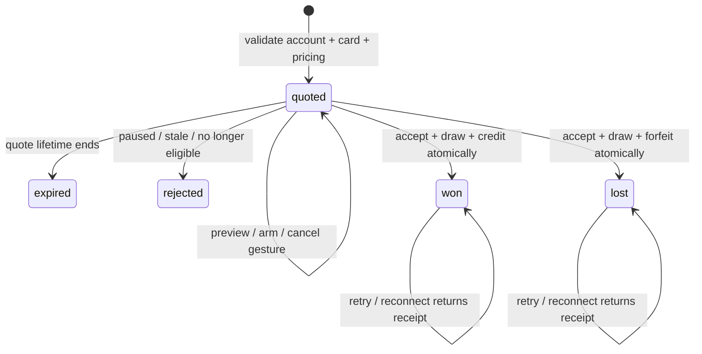

# Vault coin flip — design

Date: 2026-10-28 (Asia/Kuala_Lumpur).
Status: builder-reviewed design draft for user review; implementation has not been authorized by approval of this document.

## Intent

Let a player risk one card held in their Vault. A win preserves the card and pays normal site Credit equal to 100% of its confirmed MYR market value. A loss forfeits the card to Polycards and pays nothing. The interaction is a tangible black titanium coin the player can drag and flick. The financial result is decided and recorded on the server; the animation reveals it.

This is a project spanning storefront, admin, Pull lifecycle, ledger, reporting, and tests. It is not only an animation change.

## Confirmed user decisions

| Decision | Rule |
| --- | --- |
| RM100 example | Win: keep card and receive RM100 Credit. Loss: forfeit card, receive RM0. |
| Eligibility | Require an account already eligible for withdrawal. Existing account freezes and bank security rules remain applicable. |
| Funding origins | Include bonus-funded and gift-funded cards. |
| Odds groups | Reuse the same player-group selection and odds-set identifiers as packs. |
| Admin/public split | Admin configures actual odds and published odds. Storefront receives published odds only. |
| Appearance | Coin B: black titanium with silver rim and Polycards emblem. |
| Interaction | Drag/flick, realistic rotation, falling, impact, bounce, and settling. |

No numeric win probability has been selected. The earlier 50% example was illustrative, not approval of a default.

## Approaches

| Approach | Tradeoff | Decision for this draft |
| --- | --- | --- |
| Layered images with CSS rotation | Small bundle, but weak edge geometry, changing reflections, and contact motion | Not recommended for the requested physical feel. |
| A 3D coin with physics-derived, outcome-matched replay | Convincing material and impact; controllable duration; authoritative outcome | Recommended engineering approach. User selected its appearance and requested this design, not a particular library. |
| Unrestricted browser physics determines the result | Gesture can affect the landing; incompatible with authoritative configurable odds and unsafe to trust for money | Excluded. |

Use Three.js for the scene/material and Rapier to generate and validate physical trajectories. Generate a small library of successful landings for each face at build/asset-authoring time; ship compact replay data rather than a physics runtime if this preserves the required interaction. If live physics is necessary, keep it in the lazy-loaded feature boundary. Gesture selects a motion profile, never financial probability. The builder may choose the lightest implementation meeting the acceptance criteria.

## Product rules and explicit defaults

The following are engineering/product proposals for this draft, not additional user answers:

- One card per round; no batches, autoplay, double-or-nothing ladder, or cash stakes.
- Heads (large emblem) is the winning face; tails (wordmark) is the losing face. Explain this before confirmation. No heads/tails picker in v1.
- A won card may be selected again through a fresh explicit confirmation and quote. No automatic replay or preselected next stake.
  - **Superseded 2026-10-30 (owner decision):** a win offers Flip again, which preselects the same cards, ticket amount and call. It still needs a fresh quote and Confirm, and never replays by itself. Lucky Draw tickets can also go into a flip, alone or beside cards: a win doubles the staked tickets and a loss takes them. See `docs/operations/vault-coin-flip.md`.
- Include ordinary, bonus, gift, reward, and unlocked free-welcome card Pulls with valid catalog valuation. An unopened gifted pack is not a card. Preserve the existing first-paid-open restriction for locked free-welcome cards.
- Lost cards stay as auditable Pull records with a dedicated `forfeited` status. They do not become `bought_back`, get deleted, or produce a zero-value buyback.
- Forfeiture transfers the claim to the house but does not automatically add a physical unit to draw stock in v1. Keep `stock_earmarked` intact. Admin history identifies forfeited holdings; subsequent stock reconciliation is an existing inventory operation, outside this feature. This avoids copying buyback's best-effort stock increment into a money settlement.
- A flip changes neither historical pack-open value nor VIP, referral, task-open, or challenge progress. It is not a new pack open. Current Vault ownership/value naturally falls when a card is forfeited.
- No numeric odds, maximum stake, or enabled state is seeded for production. Feature starts disabled. Admin must configure a positive maximum card value and all required effective rates before enabling.

### Withdrawal eligibility and bonus exception

Check account authentication/lifecycle restrictions, freeze state, at least one qualifying top-up under the existing rule, and completed playthrough at acceptance. An eligible player can have a zero Credit balance: do not implement eligibility as `withdrawable > 0`. Holding an eligible card is enough; no Credit is debited to flip.

Normal Credit from a winning flip has zero bonus and external-funded basis. It does not create a new playthrough requirement. Existing withdrawal flow, minimums/fees, destination cooling-off, approval thresholds, and account holds still apply. "Withdrawable" means eligible to request withdrawal, not an automatic transfer to a bank. A later deposit or account hold can change eligibility under current wallet rules.

Including bonus/gift cards creates a deliberate exception to the money path described in [ADR 0010](../../adr/0010-bonus-credit-is-a-ledger-column.md): this chance-based win can produce normal Credit without playing the win through packs. It does not change the original card's `source` or `bonus_bp`. A later buyback of a winning bonus/gift card still stamps its existing playthrough share. Implementation must document this scoped exception in CONTEXT.md and ADR 0010 rather than silently rewriting the buyback rule.

### Valuation

Use the same displayed market-value seam as Vault: catalog USD FMV × strict FX quote × card market multiplier, converted to MYR and rounded to integer sen once. This follows the player's visible Value, not the instant/vault buyback amount or historical `recorded_value_usd`.

Accept re-reads the live value under the lock and refuses if the bundle is now worth less than quoted (added 2026-10-30, after the stake cap went: a falling price would otherwise pay the old value for up to 60 seconds). A value that rose settles at the quote. Reject absent, nonfinite, nonpositive pricing, unavailable strict FX, expired quotes, unsafe integer sen, and values above configured maximum. Snapshot raw USD value, multiplier, FX, valuation timestamp, MYR stake, and exact winning Credit. Never accept a client-provided amount as authority. Quote expires after 60 seconds (proposed default, no extra configuration). A valid quote fixes value for its brief lifetime; expiration requires a fresh quote and confirmation. Catalog freshness follows the existing valuation pipeline; this feature does not invent a second market-price source.

## Odds configuration and publication

Reuse `resolveOddsSetForCustomer` and the existing DEFAULT/effective-player-group precedence. Supported set identifiers are 1, 2, and 3. These select coin-specific win probabilities: do not reuse a pack's card pool, rarity allocation, or target-RTP solver.

One coin-flip configuration contains feature enabled state, maximum card value, actual win percentage for set 1, optional set 2/set 3 overrides, authored published win percentage, and a revision. Preserve pack fallback semantics: unset set 2 inherits set 1; unset set 3 inherits set 2 then set 1. Explicit zero means 0%, never inheritance. Admin sees effective rates and inheritance labels. Loss probability is the complement, not another editable field.

Support the pack percentage precision of four decimal places using integer millionths of total probability: 0.0001% = 1 unit, 100% = 1,000,000 units. Validate finite percentages in [0, 100] on server; draw with cryptographic `randomInt(1_000_000)`, win iff roll < effective win units. No `Math.random`, modulo bias, frontend RNG, adaptive rates based on streaks, or mutation of an accepted round.

Save/publish all configuration fields as one validated revision with actor/time and before/after audit. No intermediate partially updated configuration is playable. Publishing invalidates unaccepted quotes from older revisions. Accepted rounds keep their recorded settings. Global pause blocks acceptance but does not hide or reverse completed results.

The requested public contract is explicit allowlisting: published odds, quote value, public state, and final result only. Actual rates, set/group identifiers, RNG roll, and internal configuration snapshots stay in authorized admin/server records, not public payloads, rendered HTML, telemetry, or cached client state. An opaque revision can identify stale quotes without leaking the settings.

The user chose independent actual and published configuration, matching packs; this draft does not silently replace that decision with a single rate. A mismatch is a trust/disclosure issue and must be visible to the operator in admin. Publish-time admin warning shows each effective rate beside the published rate. Public copy says **Published win chance**, never promises 50/50 merely because this is a coin. Production review must establish that probability disclosures accurately describe the offer; hiding internal settings is not evidence that inaccurate disclosures are acceptable. No claim of "provably fair" or player-verifiable randomness is made in v1.

## Player experience

### Entry and quote

- Add `Coin flip` to the existing Vault card action surface when exactly one card is selected. Preserve selection, buyback, and shipping behavior.
- Route: `/vault/coin-flip?pull=<id>`, reached through the Games sheet or Vault card action. Preserve the current six-tab shell (Task, Ranks, Games, Home, Vault, Me); Games is active on this page. Use existing Pill primitives.
- Replace the dropdown with a searchable visual Vault modal. Keep the selected slab on the right of the tabletop on desktop, below it on phones. Five recorded throw strengths respond to flick velocity. Wins lift/light-sweep the retained card; losses lower and dim it. Both show an explicit receipt, with a static reduced-motion alternative.
- Page starts with chosen card, live server quote, published win chance, and rules. Ineligible accounts get the existing specific explanation/remedy rather than a dead control.
- Before arming the gesture, show a confirmation sheet: **Risk this card?** / **Win: keep your card + RM100.00 Credit.** / **Lose: this card leaves your Vault.** Values are from the quote. Include `Cancel` and `Confirm card` actions.
- Confirmation arms only this quote. It does not settle the stake. Cancel/back before flick is harmless. While armed, show `Flick up to flip` and an equivalent `Flip coin` button. Mark this explicit acceptance boundary in copy: **Releasing a flick starts your round.**

### Flick and reveal

- Coin follows drag within a bounded tabletop region, with constrained tilt. Below-threshold release returns it to rest without submitting. A valid flick release or button press submits the same quote ID.
- Prevent page scrolling only while pointer is captured on the coin; release capture on cancel/unmount. Direction/speed tune lift, spin, and small lateral travel within safe limits.
- Await authoritative acceptance/result before the outcome-matched throw begins. While request is unresolved, show `Confirming flip…` with restrained movement; never invent a temporary outcome.
- Gesture controls how the coin moves, not the chance of winning. Disclose this plainly in the rules. Replays do not have last-frame face swaps or impossible snap corrections.
- Target about 2–3 seconds for throw, 1–2 diminishing impacts, wobble, and settle. Impact audio follows actual replay contacts. Reuse SoundProvider/mute state; audio begins only after user interaction. Haptics are optional progressive enhancement.
- Show server result text as soon as received, alongside the optional reveal. Provide `Skip animation`. Neither Credit nor the ability to inspect the result depends on animation completion.
- Win copy: **You won +RM100.00** / **Your card stays in your Vault.** Loss copy: **Card forfeited** / **No Credit added.** Show round receipt and link back to Vault. Avoid near-miss messaging, coin showers, or an automatic new stake.

### Layout and accessibility

Phone hierarchy: back/title + account balance → compact staked-card/value row → large coin/tabletop → published chance/rule summary → thumb-reach action. Result uses the same layout without moving the main controls unexpectedly. Desktop widens into stake details beside the coin stage; retain existing shell and fluid gutters.

Use DESIGN.md ink/charcoal/graphite, Nekst for meaningful amounts, Geist for instructions, white Pill primary, hairline borders, and normal money-green only for actual credited winnings. Coin B's silver rim must separate clearly from the dark tabletop. A physical coin and grounded contact shadows are a scoped exception to the old anti-crypto "no glossy 3D coins" wording; this is a functional game object, not decorative crypto imagery. No broader visual-system change.

Keyboard/tap can complete every action without dragging. Accessible live status announces acceptance/result once. Focus returns predictably after confirmation. Minimum 44px targets. Under reduced motion, reveal the result and static final face immediately. WebGL unavailable/context loss uses the same static face and text; a completed round never becomes an error or another charge.

## Selected artwork

Generated with the built-in image generation tool using `public/branding/polycards-logo.png` as brand reference. This is appearance reference, not a final texture atlas or exact-logo master. Production faces use the official emblem/wordmark directly, preserving their geometry. Author face artwork, rim, normal/roughness treatment, two static face fallbacks, compact motion replays, and a small muted impact sound set. Export only the selected coin; A/C are exploration, not selectable skins.

The front emblem and reverse wordmark must remain visually distinct during the final rest. Use a centered view with sufficient perspective to show the bevel and real edge thickness. No real-world denomination or promise of monetary value on the coin itself.

## State and settlement

The database need only persist `quoted`, `won`, and `lost`; expiry/rejection can be derived without background jobs. A quote is not a card reservation. Financially accepted means the transaction has committed a terminal outcome. Animation is entirely client presentation and has no persisted settlement status.

### Minimum persistent shape

- `coin_flip_config`: single current config/revision; existing config-audit mechanism records changes.
- `coin_flip_round`: opaque unique ID (also the acceptance idempotency key), customer, Pull, quoted/terminal state, created/expiry/settled timestamps, source/bonus share, valuation snapshot, config revision, group/set snapshot, actual/published win units, random roll, outcome, credited amount, and nullable winning credit transaction ID. Public serializers never spread this record.
- `pull`: add terminal `forfeited` enum and `flip_version` integer default 0. Quote snapshots version. Increment on every accepted flip, including wins, so two quotes prepared against the same card version cannot both settle. Preserve ownership history and funding tags.
- `credit_transaction`: add `coin_flip_win` reason. Winning row uses `source_transaction_id = coin-flip:<round-id>` with database-backed uniqueness for this reason and `pull_id = null`. Existing `pull_id` is unique for buybacks: using it for wins would prevent repeated wins and later legitimate buyback. Link round → Pull separately.
- Economic ledger: add an explicit coin-flip event type and sanitized customer receipt payload. Win: wallet delta +V, vault delta 0. Loss: wallet delta 0; vault delta −V for tracked cards, or 0 for `source='reward'` cards whose mint added no tracked vault liability. Every loss retains full V in the receipt, event payload and forfeited-value report. Internal probabilities live in protected round/config records, never the customer-visible ledger payload.

### Acceptance transaction

1. Authenticate owner; load owned round. Another user's ID and missing ID have the same not-found response. Terminal owned rounds return the original receipt before current eligibility/expiry checks, including when account conditions later changed.
2. Acquire existing per-customer Credit lock, then round/Pull locks in one documented shared order. All reads/writes below use the same transaction manager. No external API or animation waits inside the transaction.
3. Re-read lifecycle/freeze/top-up/playthrough eligibility and card ownership/status/version. Recheck free-welcome lock where applicable, feature enablement, quote expiry, config revision, and effective group/set. If publication/group selection changed, reject as stale and require a new quote; do not substitute odds silently. Configuration/group snapshot reads must have a defined database serialization point, not a mix of caches and outside-transaction reads.
4. Validate stored server quote and limits. Draw once. A win writes normal Credit and leaves Pull vaulted; a loss conditionally changes it to forfeited and writes no Credit. Both increment flip version and write the economic event and terminal round together.
5. Commit, then return a safe receipt and fresh wallet/Vault summaries. Invalidate frontend account/Vault/history caches. Response failures do not roll back a committed result. Retry with the same ID retrieves it.

If the transaction fails before commit, no result, Credit, or forfeiture survives; no outcome is returned. Do not label an unknown network outcome a loss or offer a fresh round before checking the original ID. Show `Checking your result…` and retry/read that round. Persist the pending round ID locally only for reconnection, never trusted economics. New confirmed rounds require a new quote, with rate limits on quote creation and acceptance.

### Cross-action correctness is part of scope

Current `buybackPullStep` inserts Credit before calling `transitionPullStatus`, with compensating deletion on failure. Copying that sequence or merely adding a row lock in coin flip does not establish an atomic ownership/money boundary across both actions.

Implementation must put buyback's money + Pull transition within the same transaction/lock discipline as flip acceptance, preserving all existing pricing, free-welcome, bonus-share, freeze, idempotency, validation, and error behavior. Delivery claims/cancellation, admin Pull mutations, and account holds must also honor the shared lifecycle boundary where they race these actions. Do not expand this into a general workflow framework. Audit all callers and prove concrete overlap cases in integration tests. Existing buyback stock handling is not silently changed by coin forfeiture.

## Admin surface and reporting

Add a Coin Flip section within current admin navigation:

- Settings: enabled/paused, maximum eligible card value in RM, set 1/2/3 rates with inherited values, published win chance, mismatch warning, revision, save/publish action. Preview public copy without exposing actual rates to storefront.
- History: round/time/player/card, funding origin, locked value, outcome, credited value, effective group/set, actual/published odds, and configuration revision; filters for result, source, player, and date. Quotes and failed attempts are separate from settled counts.
- Detail: immutable audit receipt; private RNG roll and internal rates require existing appropriate admin permission. No "change result", reroll, or delete-round action.
- Reuse customer-group management for set assignment; do not create coin-specific group membership or edit pack rates as a side effect.

Extend customer transactions with clear Coin flip won/forfeited receipts; losing rounds appear even without a CreditTransaction. Extend admin accounting and exports to recognize the new reason/event. `economy.ledgerTotals` currently throws on unknown reasons, so it must be updated in the same change. Report flip payouts and forfeited quoted value separately. Returned card valuation is not cash revenue; no claim of realized profit until inventory/accounting supports it. Preserve lifetime pack activity metrics and funding basis.

## Change reach

| Area | Existing integration points / required reach |
| --- | --- |
| Domain/model/migrations | packs models Pull, CreditTransaction, LedgerEntry; new round/config; enum checks, indexes, guarded rollback |
| Core settlement | packs service Credit lock/transaction context, walletSummary, withdrawal gate, claimRows/transitionPullStatus, buyback workflow and racing delivery/admin callers |
| Group/odds | odds-sets effectivePlayerGroup/resolveOddsSetForCustomer and inheritance; config-audit; no duplicated group precedence |
| Pricing | pricing.displayMarketPrice and strict FX; current catalog value/multiplier |
| HTTP/auth | owned quote/accept/read/history store routes, admin settings/history, auth/freeze/rate-limit middleware; explicit public response allowlists |
| Storefront | VaultClient/VaultActionBar, new server route + client scene, existing actions/schemas, shell route matching, wallet/cache refresh, transaction labels/history, i18n/error mapping |
| Motion/audio | usePrefersReducedMotion, SoundProvider, lazy 3D scene, official logo, selected asset/fallbacks |
| Accounting | credit-summary, economy.ledgerTotals, economic ledger type/payload/readers, player/admin reports and exports, account erasure retention |
| Docs/fixtures | CONTEXT.md, ADR 0010 exception, DESIGN.md scoped coin surface, API/contracts, isolated fixtures for each source/set/outcome |

Proposed routes: `POST /store/coin-flips/quotes`, `POST /store/coin-flips/:id/accept`, `GET /store/coin-flips/:id`, owned paginated history, admin config/history. Exact filenames/route naming are builder choices consistent with the repo. There is no frontend settle/result-submission endpoint.

Before product code, read relevant installed Next.js guides under `node_modules/next/dist/docs/`. Use an isolated feature worktree and install its dependencies as repo instructions require. Current checkout contains unrelated edits/deletions; this design must not claim they are validated or repair them implicitly.

## Verification and delivery criteria

- Money tests: 0%, 100%, threshold boundaries, all three sets and fallback/explicit zero; exact MYR rounding; bonus/gift wins produce normal Credit with no new basis; losing card produces no Credit; untouched card provenance and later buyback basis.
- Eligibility tests: zero-balance eligible account, no top-up, outstanding playthrough, frozen/disabled account, locked free welcome, gifted unopened pack, missing/invalid card valuation, changed group/config, expiration, and paused feature.
- Transaction/concurrency integration tests: same-ID retries pay once; two quoted versions of same card settle at most once; repeated freshly confirmed wins work; win then buyback works despite unique buyback pull_id; flip vs buyback/delivery/admin hold; forced failure at each database-write boundary leaves no half-state.
- Privacy tests: store endpoints/HTML/receipts never reveal actual probabilities, group/set, or RNG; owners cannot read another player's rounds; admin permission boundaries; validation ignores/rejects client-supplied amount/outcome/rate.
- Reporting tests: every new reason/event is recognized, loss appears in customer history, forfeited value stays separate from cash revenue, no extra VIP/referral/challenge/pack-open credit, and existing withdrawal security remains unchanged.
- Visual/browser tests with existing Playwright capture/measure workflow against production standalone build: phone/desktop, drag/tap/keyboard, cancellation, double click, slow network/reconnect, reduced motion, muted audio, context loss and fallback. Inspect coin face readability, grounded impacts, real value/rule copy, focus, and target sizes. Aim for smooth 60fps on a representative midrange phone; measure before claiming it.
- Deployment: additive migrations and backend compatibility before frontend exposure; feature disabled until explicit configuration and rollout. Pause preserves receipts. Never roll back/drop populated financial records to undo a release.

## Review notes and limits

Builder check completed 2026-10-28: no important unanswered planning questions. This was a document review, not code or runtime validation.

User decisions are in the confirmed table. Single-card rounds, fixed winning face, manual repeat, free-welcome restrictions, 60-second quotes, forfeited stock quarantine, scoped reporting, and physics replay are proposed defaults for approval. Numeric odds and stake limit are operator configuration, not blockers to building disabled functionality.

As previously raised, staking cards for cash prizes needs jurisdiction/payment-provider review before real-value launch. This document is technical/product design, not legal clearance. Likewise, independent published odds require truthful probability disclosure review; this design records the requested separation rather than claiming disclosure compliance.

Technical sources consulted: [Three.js physically based materials](https://threejs.org/docs/pages/MeshStandardMaterial.html), [Rapier rigid-body physics](https://rapier.rs/docs/user_guides/javascript/rigid_bodies/). Core behavior above is grounded in the local repository snippets, not an assertion that the new feature has been tested.

Implementation planning follows approval of this design. No production code, dependencies, live configuration, or player balances are changed by this document.
